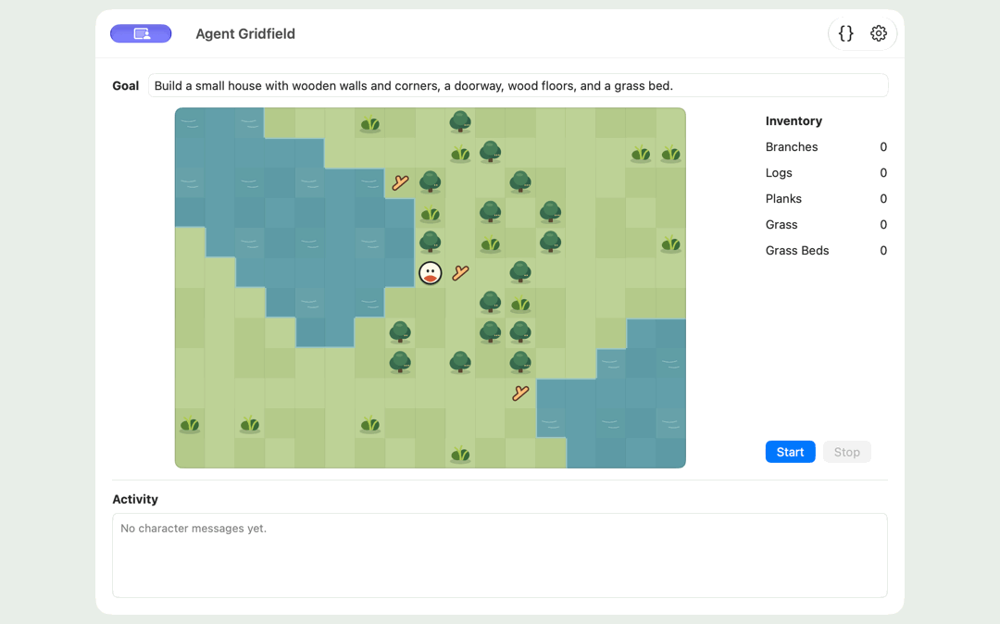

# Agent Gridfield

A simple, beautiful open-source sandbox for AI agents.

Give an agent a goal and watch it gather resources, craft, and build in a small grid world. Open Developer Tools to inspect its API requests, tool calls, notebook, and the maps it asks to see.



*Recorded in the macOS app with scripted model responses.*

## Quick start

**macOS 14 or later.** The prebuilt app is for Apple Silicon (arm64).

1. Download the macOS ZIP from this repository’s Releases page, unzip it, and open `GridWorld.app`.
2. Open **Settings** (⌘,) and save your API key. The default configuration uses OpenAI with `gpt-5-mini`. You can also configure a Chat Completions-compatible endpoint with function tool support.
3. Keep the default house-building goal or enter your own, then click **Start**. The map shows each action as it happens. The **Activity** panel shows what the character says.

Use **Stop** to interrupt a run. Starting again uses the current map and inventory. Reopening the app starts a fresh world.

The macOS ZIP uses an ad hoc signature and has no Apple notarization. You can also build the app locally.

## Build from source

Use a Swift 6 toolchain on macOS. The app has no third-party dependencies.

```sh
./Scripts/build-app.sh
```

Open `dist/GridWorld.app`. See the [reference](docs/reference.md) for API settings, Developer Tools, the tool protocol, debug exports, and test commands.

## License

[MIT](LICENSE)
